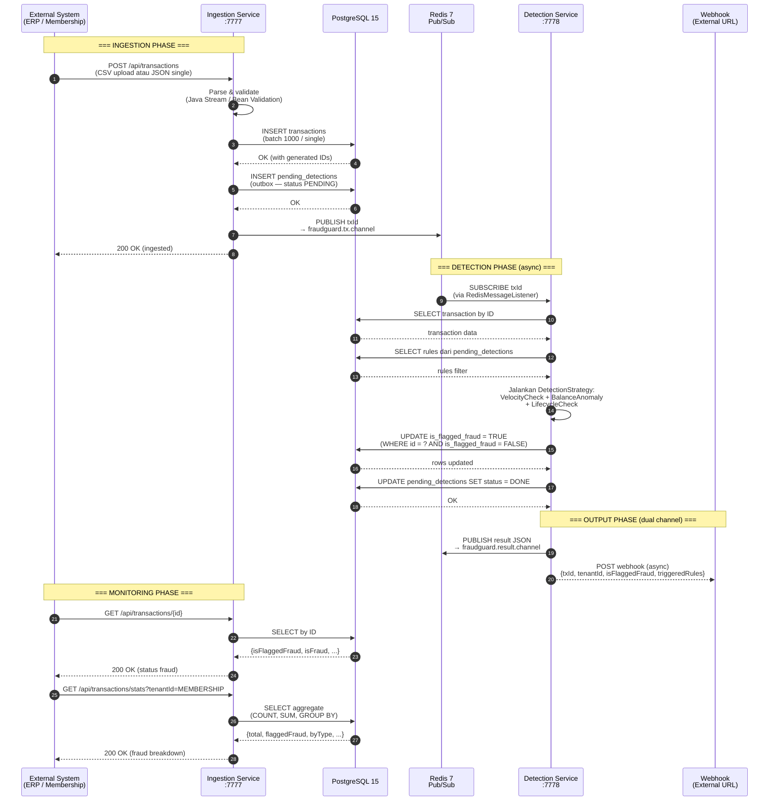
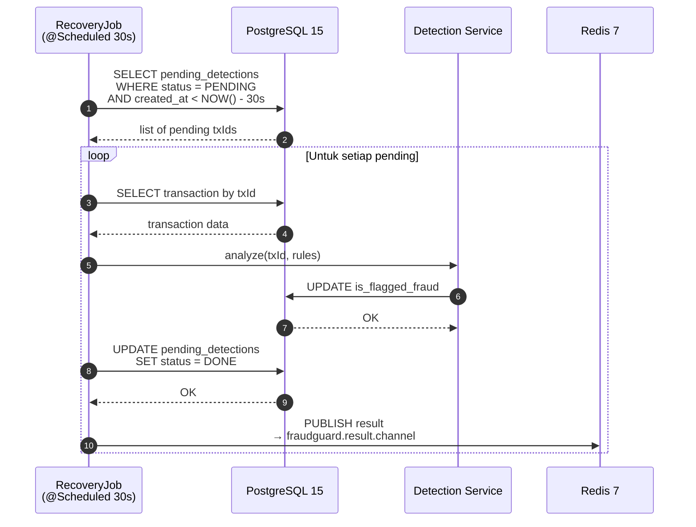
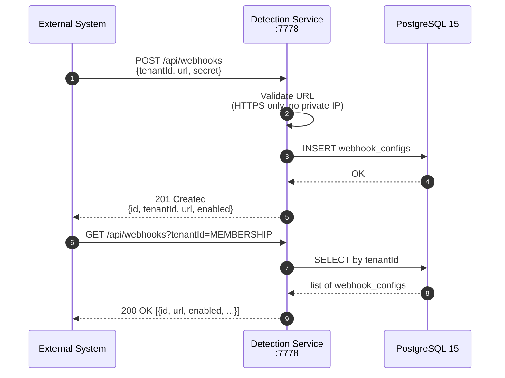

# 04 — System Architecture

**Audience**: Semua level engineer. Dokumen ini menjelaskan bagaimana sistem FraudGuard disusun dan bagaimana data mengalir antar komponen.

---

## 4.1 Gambaran Umum

FraudGuard menggunakan arsitektur **mini-microservices** dengan 2 service utama:

1. **Ingestion Service** — bertugas menerima data CSV dan menyimpannya ke database.
2. **Detection Service** — bertugas mendengarkan event baru dan menjalankan aturan fraud.

Kedua service berkomunikasi secara **loosely coupled** menggunakan **Redis Pub/Sub** sebagai message broker. PostgreSQL digunakan sebagai database tunggal (single source of truth).

> 💡 **Loosely coupled** artinya kedua service tidak saling bergantung secara langsung. Ingestion Service tidak tahu Detection Service sedang online atau tidak. Dia cukup publish pesan ke Redis.

---

## 4.2 Architecture Diagram

```text
┌──────────────────────────────────────────────────────────────────────────────────────┐
│                         Docker Network: fraudguard-net                                │
│                                                                                      │
│  ┌──────────────────────────┐              ┌──────────────────────────┐              │
│  │   INGESTION SERVICE      │   Redis      │   DETECTION SERVICE      │              │
│  │   (Port 7777)            │   Pub/Sub    │   (Port 7778)            │              │
│  │                          │              │                          │              │
│  │  • Load CSV              │  tx.channel  │  • Spring IoC            │              │
│  │  • Java Stream           │  ─────────▶  │  • Strategy Pattern      │              │
│  │  • Publish event         │              │  • Subscribe event       │              │
│  │  • Stats / Eval API      │  result      │  • Analyze (3 strategy)  │              │
│  │  • GET by ID             │  .channel    │  • Webhook delivery      │              │
│  └──────────┬───────────────┘  ◀─────────  └──────────┬───────────────┘              │
│             │ write                    output         │ read / update                 │
│             ▼                          ▲              ▼           │                  │
│  ┌──────────────────────┐              │ ┌──────────────────────┐  │                  │
│  │   POSTGRESQL 15      │              │ │   REDIS 7            │  │                  │
│  │                      │              │ │                      │  │                  │
│  │  • NUMERIC(18,2)     │              │ │  • Pub/Sub Broker    │  │                  │
│  │  • BOOLEAN native    │              │ │  • Result Channel    │  │                  │
│  │  • Multi-tenant      │              │ │  • In-Memory Cache   │  │                  │
│  │  • Outbox recovery   │              │ │                      │  │                  │
│  └──────────────────────┘              │ └──────────────────────┘  │                  │
│                                        │                           │                  │
│                           Webhook HTTP POST (async, SSRF-safe)     │                  │
│                           ─────────────────────────────────────────▶                  │
│                           External Systems (ERP, Membership, etc.)                    │
└──────────────────────────────────────────────────────────────────────────────────────┘
```

---

### 4.2.1 Diagram Versi Mermaid (Render di GitHub/GitLab)

Diagram di atas juga tersedia dalam format Mermaid agar bisa dirender otomatis di GitHub, GitLab, atau editor yang mendukung.

```mermaid
graph LR
    subgraph fraudguard-net["Docker Network: fraudguard-net"]
        ING["Ingestion Service<br/>Port 7777<br/>• Load CSV<br/>• Java Stream<br/>• Publish event"]
        DET["Detection Service<br/>Port 7778<br/>• Spring IoC<br/>• Strategy Pattern<br/>• Subscribe event"]
        DB[(PostgreSQL 15<br/>• NUMERIC(18,2)<br/>• BOOLEAN native<br/>• Updatable CTE)]
        REDIS["Redis 7<br/>• Pub/Sub Broker<br/>• In-Memory Cache"]
    end

    ING -->|Write| DB
    ING -->|Publish txId<br/>fraudguard.tx.channel| REDIS
    REDIS -->|Subscribe| DET
    DET -->|Read / Update| DB
```

> 💡 **Catatan**: Jika Mermaid tidak terender di tempat kamu membaca, diagram ASCII di bagian 4.2 tetap tersedia sebagai fallback.

---

## 4.3 Penjelasan Komponen

### Ingestion Service (Port 7777)

| Aspek | Penjelasan |
|---|---|
| **Tugas** | Menerima file CSV, membersihkan data, menyimpan ke PostgreSQL, dan publish event. |
| **Teknologi** | Spring Boot, Java Stream API. |
| **Port** | 7777. |
| **Database** | Menulis ke PostgreSQL. |
| **Message Broker** | Publish ke Redis Pub/Sub. |

Analogi: Ingestion Service seperti **pintu masuk** gedung. Semua tamu (data) masuk lewat sini, dicek, lalu dicatat.

---

### Detection Service (Port 7778)

| Aspek | Penjelasan |
|---|---|
| **Tugas** | Subscribe event transaksi baru, menjalankan strategy, mengupdate flag fraud, dan mengirim hasil via Redis result channel + webhook HTTP. |
| **Teknologi** | Spring Boot, Strategy Pattern, Spring IoC, RestTemplate. |
| **Port** | 7778. |
| **Database** | Membaca dan mengupdate PostgreSQL. |
| **Message Broker** | Subscribe dari Redis Pub/Sub. Publish hasil ke fraudguard.result.channel. |
| **Output** | Redis result channel (internal) + Webhook HTTP POST (external). |

Analogi: Detection Service seperti **petugas keamanan** yang memantau CCTV. Begitu ada tamu baru, dia langsung cek apakah tamu tersebut mencurigakan. Jika ya, dia memberitahu resepsionis (Redis) dan mengirim notifikasi ke pihak luar (webhook).

---

### PostgreSQL 15

| Aspek | Penjelasan |
|---|---|
| **Tugas** | Menyimpan data transaksi secara permanen (single source of truth). |
| **Keunggulan** | `NUMERIC` untuk uang, `BOOLEAN` native, dan Updatable CTE. |
| **Persistensi** | Data disimpan di Docker volume agar tidak hilang saat container restart. |
| **Multi-tenancy** | Kolom `tenant_id` di setiap tabel, index untuk query per tenant. |
| **Outbox** | Tabel `pending_detections` menjamin tidak ada transaksi yang terlewat diproses. |

Analogi: PostgreSQL seperti **arsip resmi** perusahaan. Semua catatan disimpan dengan aman dan rapi.

---

### Redis 7

| Aspek | Penjelasan |
|---|---|
| **Tugas Pertama** | Message Broker via Pub/Sub. |
| **Tugas Kedua** | In-Memory Cache (jika dibutuhkan di masa depan). |
| **Keunggulan** | Ringan, cepat, dan mudah dijalankan dalam container. |

Analogi: Redis seperti **buku tamu sementara** di meja depan. Tamu baru dicatat di sini, lalu petugas keamanan langsung tahu.

---

## 4.4 Alur Data (Step-by-Step)

```text
Step 1: Data Engineer mengunggah file CSV ke Ingestion Service.
        │
        ▼
Step 2: Ingestion Service membaca CSV dan memproses data dengan Java Stream.
        │
        ▼
Step 3: Data transaksi disimpan ke PostgreSQL.
        │
        ▼
Step 4: Ingestion Service publish ID transaksi ke Redis Pub/Sub channel fraudguard.tx.channel.
        │
        ▼
Step 5: Detection Service menerima event dan mengambil transaksi dari PostgreSQL.
        │
        ▼
Step 6: Detection Service menjalankan semua DetectionStrategy (VelocityCheck, BalanceAnomaly, LifecycleCheck).
        │
        ▼
Step 7: Jika terdeteksi fraud, Detection Service mengupdate kolom is_flagged_fraud.
        │
        ▼
Step 8: Hasil dipublish ke Redis result channel (fraudguard.result.channel) UNTUK internal services.
        │
        ▼
Step 9: Hasil juga dikirim via Webhook HTTP POST ke URL terdaftar UNTUK external systems.
```

---

## 4.5 Sequence Diagram (Mermaid)

Diagram urutan di bawah ini menunjukkan **alur lengkap** FraudGuard — dari transaksi masuk hingga hasil deteksi dikirim ke sistem eksternal.

### Alur Utama: Ingestion → Detection → Output



### Alur Recovery (Outbox)



### Alur Webhook Registration



### Penjelasan Setiap Langkah (Alur Utama)

| No | Langkah | Keterangan |
|---|---|---|
| 1 | External System kirim transaksi | Entry point: CSV upload atau REST JSON single. `tenantId` wajib di REST, default `PAYSIM` di CSV. |
| 2 | Parse & validate | CSV: Java Stream (case-insensitive header, filter amount > 0, deduplikasi). JSON: Bean Validation (`@Valid`, `@NotBlank`). |
| 3 | INSERT transactions | Batch 1000 baris untuk CSV, single untuk JSON. Semua kolom termasuk `tenant_id`. |
| 4 | INSERT pending_detections | Outbox pattern — catat txId + rules filter di tabel `pending_detections` status `PENDING`. |
| 5 | PUBLISH txId | Kirim ID transaksi ke Redis channel `fraudguard.tx.channel`. Dilakukan SETELAH DB commit. |
| 6 | Response 200 | Kembalikan response sukses ke caller. Deteksi berjalan **async** — jangan tunggu. |
| 7 | SUBSCRIBE txId | RedisMessageListenerContainer menerima event dan delegasi ke `RedisSubscriberService.handleMessage()`. |
| 8 | SELECT transaction | Detection Service ambil data transaksi dari PostgreSQL. |
| 9 | SELECT rules | Baca `pending_detections.rules` — jika ada, filter strategy; jika null, jalankan semua. |
| 10 | Jalankan strategies | Spring IoC inject `List<DetectionStrategy>` (VelocityCheck + BalanceAnomaly + LifecycleCheck). Engine jalankan filter + deteksi. |
| 11 | UPDATE is_flagged_fraud | Conditional UPDATE: `WHERE id = ? AND is_flagged_fraud = FALSE` (idempoten). |
| 12 | UPDATE pending_detections | Tandai `status = DONE` setelah selesai diproses. |
| 13 | PUBLISH result | Kirim JSON `{txId, tenantId, isFlaggedFraud, triggeredRules, evaluatedAt}` ke `fraudguard.result.channel`. |
| 14 | POST webhook | `@Async` HTTP POST ke URL terdaftar per tenant (SSRF-safe: HTTPS only, private IP blocked). |
| 15 | GET /{id} cek status | Caller bisa cek `isFlaggedFraud` per transaksi setelah beberapa detik. |
| 16 | GET /stats monitoring | Statistik per tenant dengan fraud breakdown (`totalFlaggedFraud`, `totalClean`, `flaggedFraudByType`). |

---

## 4.6 Mengapa Redis Pub/Sub, Bukan Kafka?

| Aspek | Redis Pub/Sub | Apache Kafka |
|---|---|---|
| **Kompleksitas** | Sangat ringan, satu container | Lebih kompleks, butuh ZooKeeper/KRaft |
| **Durability** | Tidak menyimpan pesan lama (fire-and-forget) | Menyimpan pesan dalam topic |
| **Acknowledgement** | Tidak ada mekanisme ack | Punya offset dan consumer group |
| **Cocok untuk** | Mini-project, latensi rendah, prototype | Sistem besar dengan million events/sec |

Untuk scope mini-project FraudGuard, Redis Pub/Sub sudah cukup karena:

- Latency antar-service bisa sangat rendah.
- Tidak memerlukan setup cluster.
- Detection Service yang sementara offline tidak akan membuat sistem utama down.

> ⚠️ **Trade-off**: Karena Redis Pub/Sub tidak menyimpan pesan, jika Detection Service offline saat event dipublish, event tersebut hilang. Untuk production skala besar, pertimbangkan Kafka atau Redis Streams.

---

## 4.7 Isolasi Antar Service

Salah satu keunggulan arsitektur ini adalah **isolasi**:

- Ingestion Service tetap bisa menerima CSV dan menyimpan ke database meski Detection Service restart.
- Detection Service bisa diupdate atau ditambah aturan baru tanpa mengubah Ingestion Service.
- PostgreSQL bisa di-backup atau di-maintenance tanpa harus menghentikan seluruh aplikasi ERP.

---

## 4.8 Kesimpulan

Arsitektur FraudGuard sederhana tapi kuat untuk scope mini-project:

- **2 service** dengan tanggung jawab jelas.
- **Redis Pub/Sub** sebagai message broker ringan.
- **PostgreSQL** sebagai database tunggal yang presisi.
- **Dual output**: Redis result channel (internal) + Webhook HTTP (external).
- **Outbox pattern** (`pending_detections` + `RecoveryJob`) menjamin tidak ada transaksi terlewat.
- **Isolasi** memastikan sistem inti tetap stabil.

Dokumen selanjutnya akan menjelaskan teknologi yang dipilih dan alasannya.
